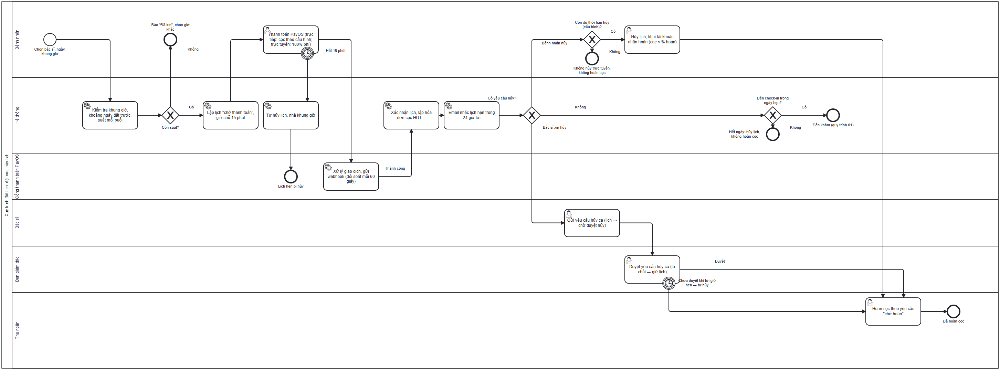
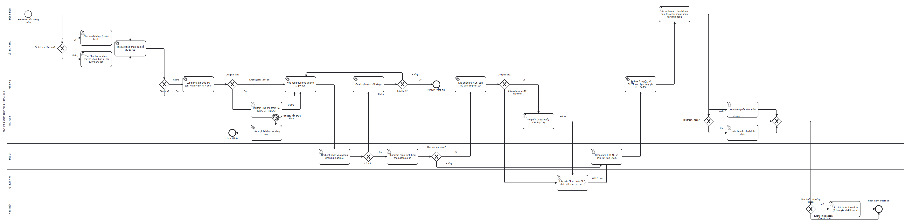
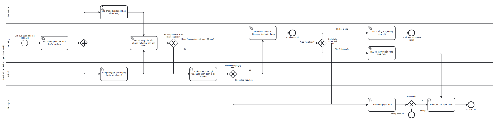

# Quy trình khám bệnh của hệ thống

Tài liệu mô tả luồng nghiệp vụ **đúng như hệ thống đang vận hành** (đối chiếu mã nguồn ngày 20/11/2026), kèm sơ đồ BPMN 2.0.
Các con số (15 phút, 3 lần, 24 giờ…) là giá trị trong mã nguồn hoặc cấu hình mặc định; mục [7](#7-tham-số-cấu-hình) liệt kê tham số giám đốc chỉnh được.

| Sơ đồ | File BPMN (mở bằng [bpmn.io](https://demo.bpmn.io) / Camunda Modeler) | Ảnh |
|---|---|---|
| 01. Khám bệnh ngoại trú trực tiếp | [01_kham_benh_truc_tiep.bpmn](bpmn/01_kham_benh_truc_tiep.bpmn) | [PNG](bpmn/01_kham_benh_truc_tiep.png) |
| 02. Đặt lịch, đặt cọc, hủy lịch | [02_dat_lich_dat_coc.bpmn](bpmn/02_dat_lich_dat_coc.bpmn) | [PNG](bpmn/02_dat_lich_dat_coc.png) |
| 03. Tư vấn trực tuyến (video call) | [03_tu_van_truc_tuyen.bpmn](bpmn/03_tu_van_truc_tuyen.bpmn) | [PNG](bpmn/03_tu_van_truc_tuyen.png) |

---

## 1. Tác nhân và trạng thái

| Tác nhân | Vai trò trong luồng |
|---|---|
| Bệnh nhân | Đặt lịch, đóng cọc, đến khám, tự lấy số ở kiosk, tư vấn trực tuyến |
| Lễ tân (`tiep_tan`) / Kiosk | Tiếp nhận, check-in, chọn đối tượng ưu tiên, điều phối hàng đợi |
| Thu ngân (`thu_ngan`) | Thu tạm ứng, quyết toán, hoàn tạm ứng dư, hoàn cọc |
| Bác sĩ (`bac_si`) | Gọi khám, khám, chỉ định cận lâm sàng, kê đơn, kết luận, tư vấn video |
| Kỹ thuật viên (`ky_thuat_vien`) | Lấy mẫu, thực hiện và trả kết quả cận lâm sàng |
| Dược sĩ (`nhan_vien_nha_thuoc`) | Cấp phát thuốc theo đơn đã thanh toán |
| Ban giám đốc (`ban_giam_doc`) | Cấu hình phí khám, tiền cọc, suất mỗi buổi, BHYT |
| Hệ thống | Tính tiền, xếp hàng đợi, tác vụ định kỳ, thông báo thời gian thực |

**Trạng thái lịch hẹn** (`lich_hen.trang_thai`): `cho_thanh_toan` → `da_xac_nhan` → `dang_kham` → `hoan_thanh`; nhánh phụ: `da_huy`, `vang_mat`, `cho_duyet_huy` (bác sĩ xin hủy ca, chờ duyệt).

**Trạng thái lượt khám** (`luot_tiep_nhan.trang_thai`): `cho_kham` → `dang_kham` → (`dang_cls` → `da_co_kq_cls`) → `cho_thanh_toan` → `hoan_thanh`; hoặc `da_huy`.

---

## 2. Đặt lịch khám và đặt cọc (sơ đồ 02)

1. **Chọn khung giờ.** Bệnh nhân (web/app) hoặc lễ tân chọn bác sĩ, ngày, khung giờ. Hệ thống kiểm tra:
   - khung giờ còn trống và trong ca trực của bác sĩ;
   - ngày đặt nằm trong khoảng "đặt trước tối thiểu / tối đa" của cấu hình;
   - **suất tối đa mỗi buổi** của bác sĩ (mặc định 3 lịch/buổi sáng hoặc chiều) — phần còn lại chừa trống để bác sĩ bù giờ khi ca trước kéo dài. Buổi đã đủ suất hiển thị "Đã kín". Giới hạn này áp dụng khi bệnh nhân tự đặt và khi đổi lịch; lễ tân đặt hộ tại quầy được vượt suất.
2. **Giữ chỗ.** Lịch hẹn tạo ở trạng thái `cho_thanh_toan`, giữ chỗ **15 phút**.
3. **Đóng cọc qua PayOS.**
   - Khám trực tiếp: cọc theo cấu hình (hiện tại 15.000 đ = 10% phí khám 150.000 đ).
   - Tư vấn trực tuyến: đóng **100% phí**.
   - Thanh toán thành công (webhook PayOS) → lịch `da_xac_nhan`, sinh hóa đơn cọc mã `HDT…`.
   - Quá 15 phút chưa thanh toán → hệ thống tự hủy, nhả khung giờ.
4. **Nhắc lịch.** Hệ thống gửi email nhắc các lịch hẹn trong 24 giờ tới (chạy định kỳ, có khóa để chỉ một instance chạy).
5. **Hủy lịch bởi bệnh nhân.**
   - Chỉ hủy được lịch đang chờ thanh toán / đã xác nhận và **chưa check-in**; lịch đã check-in, đang khám hoặc đã kết thúc thì không hủy trực tuyến.
   - Chỉ hủy trực tuyến được khi còn đủ **thời hạn hủy** do giám đốc cấu hình cho từng hình thức (hiện tại: khám trực tiếp 2 giờ, tư vấn trực tuyến 24 giờ). Bệnh nhân khai tài khoản nhận hoàn; hóa đơn cọc được đánh dấu `[CHỜ HOÀN CỌC <số tiền>]` với số tiền = cọc đã đóng × **% hoàn cọc** cấu hình.
   - Thu ngân hoàn đúng số tiền đó. Hoàn một phần thì hóa đơn cọc vẫn ở trạng thái đã thu, phần hoàn ghi vào tiền hoàn trả (phần giữ lại là doanh thu).
   - Sát giờ hơn thời hạn: không hủy trực tuyến, không hoàn cọc. % hoàn = 0 thì hủy mà không tạo yêu cầu hoàn.
6. **Bác sĩ xin hủy ca** → lịch chuyển `cho_duyet_huy`, Ban Giám Đốc duyệt (duyệt → hoàn đúng số cọc đã thu). Ca khám trực tiếp chưa được duyệt mà đã quá giờ hẹn 15 phút → hệ thống tự hủy và **hoàn cọc** (ca không diễn ra do phía phòng khám).
7. **Lễ tân hủy lịch khám trực tiếp** (màn Lịch hẹn → Hủy) phải chọn lỗi bên nào và ghi lý do. Nếu bệnh nhân đã check-in thì lượt khám bị hủy theo (xem 3.3).

| Lỗi bên nào | Lịch hẹn | Tiền cọc | Tạm ứng TU đã đóng |
|---|---|---|---|
| Phía phòng khám (bác sĩ vắng, sự cố, quá tải…) | `da_huy` | **Hoàn 100%**, nhưng phải **chờ Ban Giám Đốc duyệt** (đơn "Duyệt hoàn cọc hủy lịch"); trước khi duyệt thu ngân không chi được. Từ chối → không hoàn | Chờ hoàn |
| Phía bệnh nhân (xin hủy, không đến, bỏ về) | `da_huy` (chưa check-in) / `vang_mat` (đã check-in) | **Theo quy định hủy của giám đốc**, giống bệnh nhân tự hủy online: chưa check-in và còn cách giờ hẹn ≥ thời hạn hủy → hoàn % cấu hình; sát giờ hơn hoặc đã check-in → không hoàn | Chờ hoàn **chỉ khi chưa khám** (bác sĩ chưa lập phiếu khám); đã khám → không hoàn |
| Tiếp nhận nhầm (chỉ khi đã check-in) | Giữ nguyên `da_xac_nhan`, check-in lại được | Giữ nguyên | Chờ hoàn (lượt mới lập phiếu mới) |

- **Chống tự ý hủy:** bệnh nhân luôn được thông báo (trong app + email) kèm lý do, tên người hủy và số tiền hoàn, để khiếu nại nếu bị ghi sai. Mọi lần hủy ghi vào nhật ký `nhat_ky_huy_lich`; Ban Giám Đốc xem ở **Lịch hủy tại quầy** (tổng hợp theo nhân viên và lỗi bên nào).

---

## 3. Khám bệnh ngoại trú trực tiếp (sơ đồ 01)

### 3.1 Tiếp nhận

| Trường hợp | Xử lý |
|---|---|
| Có lịch hẹn hôm nay (`da_xac_nhan`, hình thức trực tiếp, **đã có bác sĩ phụ trách**) | Lễ tân bấm **Check-in** hoặc bệnh nhân tự check-in ở kiosk (cùng điều kiện, cùng cách tạo lượt). Lượt nhận bác sĩ, phòng (theo lịch hoặc theo chuyên khoa của bác sĩ) và chuyên khoa đã đặt của lịch. Đã có lượt chưa hủy thì dùng lại / in lại vé; lượt cũ đã hủy thì lấy số mới. Kiosk chỉ tra cứu được lịch **hôm nay**, họ tên hiển thị dạng che. |
| Khách vãng lai tại quầy | Chọn hồ sơ có sẵn hoặc nhập họ tên + SĐT; hệ thống chỉ dùng lại hồ sơ khi **trùng cả SĐT và họ tên** (SĐT được dùng chung, vd. trẻ em dùng số cha mẹ), không thì tạo hồ sơ mới (mã `BNxxxxxx`). Chọn chuyên khoa; bác sĩ tự chọn người đang trực ít người chờ nhất, phòng theo chuyên khoa của bác sĩ. |
| Khách tự lấy số ở kiosk | Tự khai họ tên, SĐT, **năm sinh (bắt buộc)**, triệu chứng; chỉ được tự khai ưu tiên *phụ nữ có thai, khuyết tật nặng, người có công*. Phân luồng theo triệu chứng (tim mạch, nhi, ngoại), dưới 16 tuổi → Nhi khoa, còn lại Nội tổng quát; chỉ xếp cho bác sĩ **đang trực**, không có thì mời ra quầy. |

- Vé hẹn điện tử (email, web, Zalo) **không có số thứ tự**: chỉ có mã lịch hẹn và mã QR chứa mã lịch hẹn (quét ở kiosk để tra cứu). Số thứ tự được cấp khi check-in và hiện lại trên vé sau đó.
- Số thứ tự **reset mỗi ngày**, hai dãy đếm riêng: `A001…` (quầy, check-in), `B001…` (kiosk vãng lai). Sinh từ bộ đếm trong CSDL nên không trùng khi nhiều máy cùng cấp số.
- Lễ tân chọn sẵn bác sĩ cho khách vãng lai thì bác sĩ phải thuộc chuyên khoa đã chọn. Kiosk và quầy cùng chống tạo trùng: đã có lượt còn hoạt động cùng chuyên khoa trong ngày thì in lại vé.
- **Đối tượng ưu tiên:** cấp cứu, trẻ dưới 6 tuổi, người từ 75 tuổi, phụ nữ có thai, khuyết tật nặng, người có công. Trẻ dưới 6 tuổi và người từ 75 tuổi **tự nhận theo ngày sinh**; còn lại lễ tân chọn (có thể đổi sau trên màn hình hàng đợi).

### 3.2 Thu phí khám trước khi khám

Bệnh nhân phải đóng đủ phần phí khám mình chi trả **trước khi xuất hiện trên màn hình bác sĩ**.

- Hệ thống lập **phiếu tạm ứng `TU<mã lượt>`** cho mọi lượt (trừ cấp cứu):
  - `số phải thu = phí khám × (1 − tỷ lệ BHYT) − tiền cọc đã đóng` (khách vãng lai: cọc = 0). Nếu ≤ 0 → phiếu 0 đ ghi "đã thu" luôn, bệnh nhân vào thẳng hàng đợi.
  - Không lập được phiếu thì lượt bị hủy và báo lễ tân tiếp nhận lại.
- Bác sĩ chỉ thấy và chỉ gọi được lượt có phiếu `TU` **đã thu** hoặc ca cấp cứu (kiểm tra cả khi gọi qua API).
- **Cấp cứu:** không thu trước, vào thẳng đầu hàng đợi, quyết toán sau.
  - Lễ tân hoặc bác sĩ chuyển cấp cứu khi bệnh nhân đang chờ; **bắt buộc ghi lý do**, quản trị được thông báo.
  - Chỉ bác sĩ (hoặc quản trị) được bỏ cấp cứu, cũng phải ghi lý do; bệnh nhân phải đóng lại tạm ứng mới được gọi khám.
- Bệnh nhân **chuyển khoản QR (PayOS)** ngay trên trang Tiến độ khám, hoặc đóng tại quầy: thu ngân bấm **Thu tạm ứng** và **tự nhập số tiền** (ít nhất số phải thu, có thể thu nhiều hơn để trừ dần các chi phí trong lượt; hai quầy cùng thu một phiếu thì chỉ một lần thành công). Phí CLS thì thu đúng số trên phiếu, không nhập tay. Tiền chuyển khoản vào là hệ thống tự ghi nhận như thu ngân thu (webhook + đối soát 60 giây/lần); áp dụng cả cho phiếu phí cận lâm sàng `CLS…`. Chuyển thiếu tiền hoặc chuyển vào phiếu đã hủy → báo thu ngân xử lý.
- Lượt chưa đóng tạm ứng **không bị hủy trong ngày** (bệnh nhân có thể đang xếp hàng ở quầy thu ngân), chỉ không hiện với bác sĩ. Hết ngày vẫn chưa khám thì hệ thống hủy lượt, lịch hẹn `vang_mat`.
- **Hoàn tạm ứng khi hủy lượt:** chỉ hoàn khi bệnh nhân **chưa được khám** (bác sĩ chưa lập phiếu khám). Đã khám rồi bỏ về / bị hủy vì lỗi bệnh nhân thì giữ tạm ứng; lỗi phía phòng khám hoặc tiếp nhận nhầm thì vẫn hoàn.

### 3.3 Hàng đợi và gọi khám

Thứ tự gọi trong hàng đợi của một bác sĩ:

| Ưu tiên | Nhóm | Sắp xếp trong nhóm |
|---|---|---|
| 0 | Cấp cứu | Theo giờ đến |
| 1 | Đối tượng ưu tiên theo luật (trẻ < 6 tuổi, người ≥ 75 tuổi, có thai, khuyết tật nặng, người có công) | Theo giờ đến |
| 2 | Có lịch hẹn, **đã đến giờ hẹn** và đến đúng hẹn (không trễ quá 15 phút) | Theo giờ hẹn |
| 3 | Còn lại (vãng lai, lịch hẹn chưa tới giờ, đến trễ quá 15 phút, người vừa qua lượt) | Theo giờ đến / giờ qua lượt |

- **Bác sĩ chậm giờ** (ca trước kéo dài): hệ thống không chặn bác sĩ mà
  - báo lễ tân và bệnh nhân khi lịch hẹn bị trễ **15 phút**;
  - trễ **30 phút**: gợi ý chuyển sang bác sĩ cùng chuyên khoa đang trực, ít người chờ nhất (lễ tân bấm chuyển);
  - màn hình tiến độ của bệnh nhân hiển thị số người phía trước và thời gian chờ ước tính theo nhịp khám thực tế trong ngày.
- **Gọi vào khám** (nút gọi loa hay đổi trạng thái sang đang khám) đi chung một đường: kiểm tra tạm ứng, chuyển lịch hẹn `dang_kham`, ghi lịch sử gọi.
- **Gọi không có mặt → qua lượt:** xếp xuống cuối hàng (tính từ lúc qua lượt), lịch hẹn trở lại `da_xac_nhan` cho tới khi được gọi lại. **Lần thứ 3** → hủy lượt vắng mặt, lịch hẹn `vang_mat` (không hoàn cọc); tạm ứng đã đóng được chuyển sang "chờ hoàn" (chưa khám).
- **Chuyển bác sĩ / phòng:** chỉ khi bệnh nhân còn `cho_kham`; bác sĩ mới phải cùng chuyên khoa (không trong ca trực thì chỉ cảnh báo).
- Bác sĩ chỉ gọi số, qua lượt, đổi trạng thái, lập / sửa / kết thúc phiếu khám **của lượt mình phụ trách**; lễ tân và quản trị không bị giới hạn.
- Lượt còn dở từ các ngày trước được hệ thống tự dọn: `cho_kham` → hủy vắng mặt; `dang_kham` / `dang_cls` / `da_co_kq_cls` (bác sĩ chưa kết thúc, bệnh nhân bỏ về) → hủy, lịch hẹn `da_huy`, tạm ứng giữ lại, CLS chưa thực hiện được hoàn phí.
- Màn hình TV sảnh chờ (công khai) che họ tên người đang chờ (`Nguyễn V. A.`); chỉ người đang được gọi mới đọc tên đầy đủ. Giọng đọc chỉ nhận câu gọi số. Kiosk và giọng đọc có giới hạn số lần gọi mỗi phút theo IP.
- Nhân viên hủy lượt: bắt buộc chọn lỗi bên nào và ghi lý do; lịch hẹn, tiền cọc và tạm ứng xử lý theo bảng ở mục 2.7. Đơn thuốc chờ duyệt, chỉ định cận lâm sàng chưa có kết quả và hóa đơn nháp bị hủy; phí CLS đã thu mà chưa lấy mẫu được hoàn, đã lấy mẫu / đang chạy thì giữ. Không hủy được lượt đã kết thúc khám, đã quyết toán hoặc đã cấp phát thuốc. Hủy hai lần liên tiếp chỉ có tác dụng một lần.

### 3.4 Khám, cận lâm sàng, kê đơn

1. Bác sĩ khám: sinh hiệu, triệu chứng, chẩn đoán sơ bộ. Phiếu khám chỉ lập được khi lượt đã được gọi vào khám, và luôn gắn vào hồ sơ của đúng bệnh nhân của lượt.
2. Cần cận lâm sàng → chỉ định xét nghiệm / chẩn đoán hình ảnh (lượt `dang_cls`).
   - **Thu trước rồi mới làm:** mỗi chỉ định có phiếu thu `CLS<mã chỉ định>` = giá dịch vụ × (1 − tỷ lệ BHYT). Tạm ứng (cọc + `TU`) còn dư sau phí khám được **tự cấn trừ** vào phiếu: dư đủ thì phiếu ghi đã thu, bệnh nhân không nộp thêm; dư thiếu thì chỉ thu phần còn lại. Chỉ định bị hủy thì trả lại phần đã cấn trừ. Thu ngân thu bằng nút "Thu phí CLS" (cùng màn hình thu tạm ứng); kỹ thuật viên **chỉ bắt đầu lấy mẫu khi phiếu đã thu** (kiểm tra cả qua API). Ca cấp cứu không thu trước, quyết toán sau.
   - Kỹ thuật viên lấy mẫu, thực hiện, nhập kết quả, tải ảnh → lượt `da_co_kq_cls`, bác sĩ nhận kết quả.
   - Hủy chỉ định chưa thực hiện: phiếu chưa thu thì hủy; đã thu thì khoản đó được trừ vào viện phí khi quyết toán (dư thì hoàn). Sau khi hóa đơn quyết toán đã thanh toán thì không chỉ định thêm.
3. Bác sĩ chẩn đoán xác định (ICD-10), kê đơn, hẹn tái khám, **kết thúc khám** → hệ thống lập hóa đơn trước; lập được thì lượt mới chuyển `cho_thanh_toan` (lỗi thì báo bác sĩ, ca khám giữ nguyên). Chỉ kết thúc được lượt đang khám, và mỗi phiếu khám chỉ kết thúc một lần.
- Bác sĩ gọi bệnh nhân có lịch hẹn vào khám → lịch hẹn `dang_kham`.

### 3.5 Quyết toán viện phí

- Hóa đơn gộp: phí khám + cận lâm sàng + thuốc, trừ BHYT, trừ cọc + tạm ứng `TU` + phí CLS `CLS…` đã thu trước.
- Không phải thu thêm cũng không phải hoàn (0 đ) → hệ thống **tự quyết toán** ngay khi bác sĩ kết thúc khám (có đơn thuốc chưa chọn nơi mua thì chờ bệnh nhân / thu ngân chọn xong): lượt `hoan_thanh`, lịch hẹn `hoan_thanh`, nhà thuốc cấp phát được.
- **Bệnh nhân xác nhận một lần:** trên màn hình thanh toán, bệnh nhân chọn hình thức (chuyển khoản / tại quầy) và nơi mua thuốc (nhà thuốc phòng khám / mua ngoài) — chỉ chọn trên máy, chưa gửi đi — rồi bấm **Xác nhận**. Khi đó hệ thống mới ghi lựa chọn thuốc, lập lại hóa đơn, báo thu ngân (nhãn "BN chọn: …" trên hóa đơn) và nhà thuốc; chuyển khoản thì lúc này mới tạo mã QR. Đã xác nhận thì bệnh nhân không tự đổi được, muốn đổi phải nhờ thu ngân.
- **Tỷ lệ BHYT:**

| Điều kiện | Tỷ lệ chi trả |
|---|---|
| Thẻ sai định dạng hoặc hết hạn | 0% |
| Mức hưởng theo ký tự thứ 3 của mã thẻ | 1, 2, 5 → 100%; 3 → 95%; 4 → 80% |
| Đúng tuyến: cấp cứu, phòng khám chưa cấu hình mã cơ sở KCB, thẻ đăng ký tại phòng khám, hoặc **giấy chuyển tuyến còn hiệu lực** | Theo mức hưởng |
| Đúng tuyến và tổng chi phí lần khám **dưới ngưỡng** cấu hình (quy định: 15% lương cơ sở) | 100% |
| Trái tuyến | Mức hưởng × % trái tuyến do giám đốc cấu hình |

- Thu ngân chọn hình thức BHYT lúc thu tiền mà hóa đơn chưa có số giảm: hệ thống tính lại theo thẻ như trên; chỉ khi chưa nhập thẻ hợp lệ mới dùng mức mặc định 80%.
- Chỉ quyết toán hóa đơn đang chờ thu của lượt **đã kết thúc khám** (`cho_thanh_toan`); hóa đơn đã hủy hoặc lượt đang khám / đã hủy thì không thu.
- Số tiền giảm thu ngân nhập phải từ 0 đến tổng viện phí, nên tiền hoàn tối đa bằng số tạm ứng/cọc đã đóng.
- Kết quả: **thu thêm** phần còn thiếu, hoặc **hoàn tạm ứng dư** (ghi `tien_hoan_tra`). Thanh toán xong → lượt `hoan_thanh`, phiếu khám `da_hoan_thanh`, lịch hẹn (nếu có) `hoan_thanh`.

### 3.6 Cấp phát thuốc

Dược sĩ chỉ cấp phát khi hóa đơn của lượt đã `da_thanh_toan`; xuất kho theo lô (hạn dùng gần nhất trước). Danh sách "Chờ cấp phát" chỉ gồm đơn đã chọn mua tại phòng khám.

---

## 4. Tư vấn trực tuyến (sơ đồ 03)

1. Lịch trực tuyến đã đóng 100% phí (`da_xac_nhan`).
2. Phòng gọi (WebRTC qua Socket.IO) mở từ **15 phút trước giờ hẹn**, đóng sau **60 phút** tính từ giờ hẹn, hoặc từ lúc hai bên gặp nhau nếu gặp muộn hơn.
3. Chỉ **bác sĩ phụ trách** và **bệnh nhân của lịch** (đăng nhập, gửi token) được vào phòng, và chỉ khi lịch đang `da_xac_nhan`. Hệ thống ghi:
   - lần đầu bác sĩ vào (`bac_si_vao_luc`) và lần đầu bệnh nhân vào (`benh_nhan_vao_luc`);
   - lần đầu **hai bên cùng có mặt** trong phòng (`gap_nhau_luc`). Đây là căn cứ duy nhất để coi ca đã diễn ra.
4. Chỉ bác sĩ phụ trách được hoàn tất ca, khi đã có `gap_nhau_luc`, đã nhập chẩn đoán và **chưa hết ngày hẹn**. Hệ thống tạo hồ sơ bệnh án (mã `HSxxxxxx`), lịch chuyển `hoan_thanh`.
5. Ca chưa kết luận được xử lý tự động (5 phút/lần):

| Tình huống | Thời điểm xử lý | Kết quả |
|---|---|---|
| Bác sĩ không vào (bệnh nhân vào hay không) | Khi phòng đóng | Hủy ca, yêu cầu **hoàn phí** |
| Bác sĩ vào, bệnh nhân không vào | Khi phòng đóng | Lịch `vang_mat`, **không hoàn phí** |
| Cả hai vào nhưng lệch giờ, không gặp nhau | Khi phòng đóng | Hủy ca, **chờ thu ngân xác minh** |
| Đã gặp nhau nhưng bác sĩ không kết luận | Hết ngày hẹn | Hủy ca, **chờ thu ngân xác minh** |

---

## 5. Tác vụ tự động của hệ thống

| Tác vụ | Chu kỳ | Nội dung |
|---|---|---|
| Quét hàng đợi | 30 giây / lần và khi có truy vấn hàng đợi, tối đa 1 lần / 5 giây | Báo trễ hẹn 15/30 phút, dọn lượt dở của ngày cũ, tự quyết toán hóa đơn 0 đ còn treo |
| Hủy lịch quá giờ | Định kỳ | Lịch trực tiếp **hết ngày hẹn** mà không check-in → hủy, không hoàn cọc, báo bệnh nhân (trong ngày hẹn, đến trễ vẫn check-in được, xếp theo giờ đến); lịch trực tiếp bác sĩ xin hủy chưa được duyệt quá giờ hẹn 15 phút → hủy, hoàn cọc; lịch trực tuyến hết giờ phòng / quá ngày → xử lý theo mục 4 |
| Hết hạn thanh toán cọc | Định kỳ / đối soát PayOS | Quá 15 phút chưa thanh toán → hủy lịch |
| Nhắc lịch | 30 phút / lần | Email nhắc lịch hẹn trong 24 giờ tới |

Các tác vụ định kỳ dùng khóa MySQL (`GET_LOCK`) nên khi chạy nhiều instance backend chỉ một instance thực hiện.

---

## 6. Hóa đơn và mã chứng từ

| Mã | Ý nghĩa |
|---|---|
| `HDT…` | Hóa đơn cọc đặt lịch (thanh toán qua PayOS) |
| `TU<mã lượt>` | Phiếu tạm ứng phí khám tại quầy |
| `CLS<mã chỉ định>` | Phiếu thu phí cận lâm sàng trước khi thực hiện |
| `HD<năm>…` | Hóa đơn quyết toán viện phí |
| `[CHỜ HOÀN CỌC …]` | Ghi chú đánh dấu khoản đã thu cần hoàn cho bệnh nhân |

---

## 7. Tham số cấu hình

Giám đốc chỉnh tại **Bảng giá dịch vụ → Quy định tiền cọc đặt lịch trước → sửa dòng khám trực tiếp**:

| Tham số | Mặc định | Tác động |
|---|---|---|
| Phí khám mặc định | 150.000 đ | Cơ sở tính tạm ứng và cọc |
| % / số tiền cọc | 10% / 15.000 đ (trực tiếp), 100% (trực tuyến) | Tiền giữ chỗ khi đặt lịch |
| Đặt trước tối thiểu / tối đa | 1 / 7 ngày | Khoảng ngày được đặt |
| Thời hạn hủy được hoàn cọc / % hoàn cọc | 2 giờ, 100% (trực tiếp); 24 giờ, 100% (trực tuyến) | Bệnh nhân hủy trực tuyến và số tiền được hoàn |
| Số lịch hẹn tối đa mỗi buổi | 3 | Chừa khung bù giờ cho bác sĩ |
| Mã cơ sở KCB BHYT | trống (không kiểm tra tuyến) | Xác định đúng/trái tuyến |
| % hưởng BHYT khi trái tuyến | 0 | Nhân với mức hưởng của thẻ |
| Ngưỡng BHYT chi trả 100% | trống (không áp dụng) | Lần khám đúng tuyến dưới ngưỡng được BHYT trả hết |
