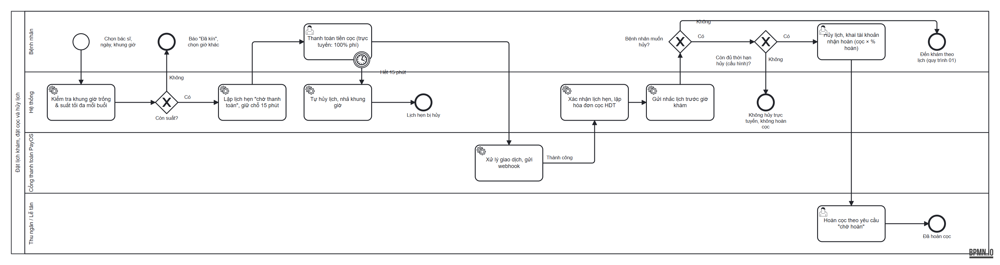
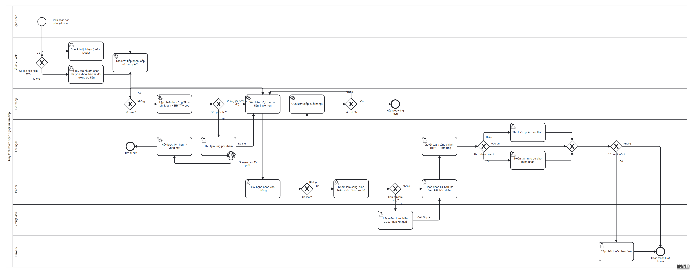
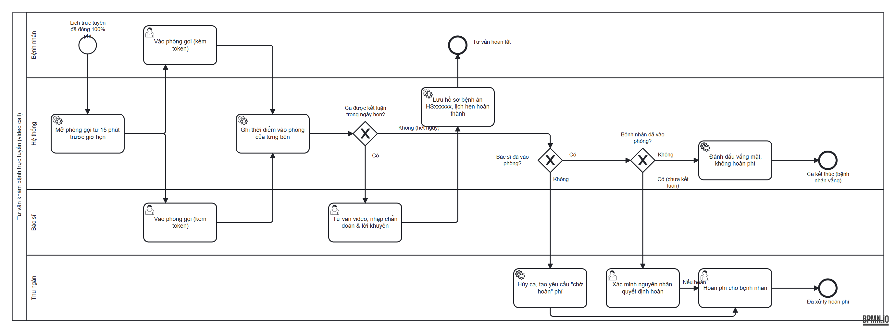

# Quy trình khám bệnh của hệ thống

Tài liệu mô tả luồng nghiệp vụ **đúng như hệ thống đang vận hành** (đối chiếu mã nguồn ngày 12/11/2026), kèm sơ đồ BPMN 2.0.
Các con số (15 phút, 3 lần, 24 giờ…) là giá trị trong mã nguồn hoặc cấu hình mặc định; mục [7](#7-tham-số-cấu-hình) liệt kê tham số giám đốc chỉnh được.

| Sơ đồ | File BPMN (mở bằng [bpmn.io](https://demo.bpmn.io) / Camunda Modeler) | Ảnh |
|---|---|---|
| 01. Khám bệnh ngoại trú trực tiếp | [01_kham_benh_truc_tiep.bpmn](bpmn/01_kham_benh_truc_tiep.bpmn) | [PNG](bpmn/01_kham_benh_truc_tiep.png) |
| 02. Đặt lịch, đặt cọc, hủy lịch | [02_dat_lich_dat_coc.bpmn](bpmn/02_dat_lich_dat_coc.bpmn) | [PNG](bpmn/02_dat_lich_dat_coc.png) |
| 03. Tư vấn trực tuyến (video call) | [03_tu_van_truc_tuyen.bpmn](bpmn/03_tu_van_truc_tuyen.bpmn) | [PNG](bpmn/03_tu_van_truc_tuyen.png) |

---

## 1. Tác nhân và trạng thái

| Tác nhân | Vai trò trong luồng |
|---|---|
| Bệnh nhân | Đặt lịch, đóng cọc, đến khám, tự lấy số ở kiosk, tư vấn trực tuyến |
| Lễ tân (`tiep_tan`) / Kiosk | Tiếp nhận, check-in, chọn đối tượng ưu tiên, điều phối hàng đợi |
| Thu ngân (`thu_ngan`) | Thu tạm ứng, quyết toán, hoàn tạm ứng dư, hoàn cọc |
| Bác sĩ (`bac_si`) | Gọi khám, khám, chỉ định cận lâm sàng, kê đơn, kết luận, tư vấn video |
| Kỹ thuật viên (`ky_thuat_vien`) | Lấy mẫu, thực hiện và trả kết quả cận lâm sàng |
| Dược sĩ (`nhan_vien_nha_thuoc`) | Cấp phát thuốc theo đơn đã thanh toán |
| Ban giám đốc (`ban_giam_doc`) | Cấu hình phí khám, tiền cọc, suất mỗi buổi, BHYT |
| Hệ thống | Tính tiền, xếp hàng đợi, tác vụ định kỳ, thông báo thời gian thực |

**Trạng thái lịch hẹn** (`lich_hen.trang_thai`): `cho_thanh_toan` → `da_xac_nhan` → `dang_kham` → `hoan_thanh`; nhánh phụ: `da_huy`, `vang_mat`, `cho_duyet_huy` (bác sĩ xin hủy ca, chờ duyệt).

**Trạng thái lượt khám** (`luot_tiep_nhan.trang_thai`): `cho_kham` → `dang_kham` → (`dang_cls` → `da_co_kq_cls`) → `cho_thanh_toan` → `hoan_thanh`; hoặc `da_huy`.

---

## 2. Đặt lịch khám và đặt cọc (sơ đồ 02)

1. **Chọn khung giờ.** Bệnh nhân (web/app) hoặc lễ tân chọn bác sĩ, ngày, khung giờ. Hệ thống kiểm tra:
   - khung giờ còn trống và trong ca trực của bác sĩ;
   - ngày đặt nằm trong khoảng "đặt trước tối thiểu / tối đa" của cấu hình;
   - **suất tối đa mỗi buổi** của bác sĩ (mặc định 3 lịch/buổi sáng hoặc chiều) — phần còn lại chừa trống để bác sĩ bù giờ khi ca trước kéo dài. Buổi đã đủ suất hiển thị "Đã kín". Giới hạn này áp dụng khi bệnh nhân tự đặt và khi đổi lịch; lễ tân đặt hộ tại quầy được vượt suất.
2. **Giữ chỗ.** Lịch hẹn tạo ở trạng thái `cho_thanh_toan`, giữ chỗ **15 phút**.
3. **Đóng cọc qua PayOS.**
   - Khám trực tiếp: cọc theo cấu hình (hiện tại 15.000 đ = 10% phí khám 150.000 đ).
   - Tư vấn trực tuyến: đóng **100% phí**.
   - Thanh toán thành công (webhook PayOS) → lịch `da_xac_nhan`, sinh hóa đơn cọc mã `HDT…`.
   - Quá 15 phút chưa thanh toán → hệ thống tự hủy, nhả khung giờ.
4. **Nhắc lịch.** Hệ thống gửi email nhắc các lịch hẹn trong 24 giờ tới (chạy định kỳ, có khóa để chỉ một instance chạy).
5. **Hủy lịch bởi bệnh nhân.**
   - Chỉ hủy trực tuyến được khi còn đủ **thời hạn hủy** do giám đốc cấu hình cho từng hình thức (hiện tại: khám trực tiếp 2 giờ, tư vấn trực tuyến 24 giờ). Bệnh nhân khai tài khoản nhận hoàn; hóa đơn cọc được đánh dấu `[CHỜ HOÀN CỌC <số tiền>]` với số tiền = cọc đã đóng × **% hoàn cọc** cấu hình.
   - Thu ngân hoàn đúng số tiền đó. Hoàn một phần thì hóa đơn cọc vẫn ở trạng thái đã thu, phần hoàn ghi vào tiền hoàn trả (phần giữ lại là doanh thu).
   - Sát giờ hơn thời hạn: không hủy trực tuyến, không hoàn cọc. % hoàn = 0 thì hủy mà không tạo yêu cầu hoàn.
6. **Bác sĩ xin hủy ca** → lịch chuyển `cho_duyet_huy`, lễ tân/quản trị duyệt.

---

## 3. Khám bệnh ngoại trú trực tiếp (sơ đồ 01)

### 3.1 Tiếp nhận

| Trường hợp | Xử lý |
|---|---|
| Có lịch hẹn hôm nay (`da_xac_nhan`, hình thức trực tiếp) | Lễ tân bấm **Check-in** hoặc bệnh nhân tự check-in ở kiosk. Đã có lượt chưa hủy thì dùng lại, không tạo trùng. |
| Khách vãng lai tại quầy | Tìm hoặc tạo hồ sơ (mã `BNxxxxxx`), chọn chuyên khoa, bác sĩ, phòng. |
| Khách tự lấy số ở kiosk | Tự khai thông tin; chỉ được tự khai ưu tiên *phụ nữ có thai, khuyết tật nặng, người có công*. |

- Số thứ tự **reset mỗi ngày**: `A001…` (quầy, check-in), `B001…` (kiosk vãng lai). Sinh từ bộ đếm trong CSDL nên không trùng khi nhiều máy cùng cấp số.
- **Đối tượng ưu tiên:** cấp cứu, trẻ dưới 6 tuổi, người từ 75 tuổi, phụ nữ có thai, khuyết tật nặng, người có công. Trẻ dưới 6 tuổi và người từ 75 tuổi **tự nhận theo ngày sinh**; còn lại lễ tân chọn (có thể đổi sau trên màn hình hàng đợi).

### 3.2 Thu phí khám trước khi khám

Bệnh nhân phải đóng đủ phần phí khám mình chi trả **trước khi xuất hiện trên màn hình bác sĩ**.

- Hệ thống lập **phiếu tạm ứng `TU<mã lượt>`**:
  - Có lịch hẹn: `số phải thu = phí khám × (1 − tỷ lệ BHYT) − tiền cọc đã đóng`. Nếu ≤ 0 → không lập phiếu, đưa thẳng vào hàng đợi.
  - Khách vãng lai: thu ngân nhập số tiền tạm ứng.
- **Cấp cứu:** không thu trước, vào thẳng đầu hàng đợi, quyết toán sau.
- Thu ngân bấm **Thu tạm ứng** (phải thu ít nhất số phải thu; hai quầy cùng thu một phiếu thì chỉ một lần thành công).
- Bệnh nhân có lịch hẹn **quá giờ hẹn 15 phút** mà chưa đóng → hủy lượt, lịch hẹn `vang_mat`, phòng khám tiếp tục ca khác.

### 3.3 Hàng đợi và gọi khám

Thứ tự gọi trong hàng đợi của một bác sĩ:

| Ưu tiên | Nhóm | Sắp xếp trong nhóm |
|---|---|---|
| 0 | Cấp cứu | Theo giờ đến |
| 1 | Đối tượng ưu tiên theo luật (trẻ < 6 tuổi, người ≥ 75 tuổi, có thai, khuyết tật nặng, người có công) | Theo giờ đến |
| 2 | Có lịch hẹn, **đã đến giờ hẹn** và đến đúng hẹn (không trễ quá 15 phút) | Theo giờ hẹn |
| 3 | Còn lại (vãng lai, lịch hẹn chưa tới giờ, đến trễ quá 15 phút, người vừa qua lượt) | Theo giờ đến / giờ qua lượt |

- **Bác sĩ chậm giờ** (ca trước kéo dài): hệ thống không chặn bác sĩ mà
  - báo lễ tân và bệnh nhân khi lịch hẹn bị trễ **15 phút**;
  - trễ **30 phút**: gợi ý chuyển sang bác sĩ cùng chuyên khoa đang trực, ít người chờ nhất (lễ tân bấm chuyển);
  - màn hình tiến độ của bệnh nhân hiển thị số người phía trước và thời gian chờ ước tính theo nhịp khám thực tế trong ngày.
- **Gọi không có mặt → qua lượt:** xếp xuống cuối hàng (tính từ lúc qua lượt). **Lần thứ 3** → hủy lượt vắng mặt; tạm ứng đã đóng được chuyển sang "chờ hoàn".
- Lượt còn `cho_kham` từ các ngày trước được hệ thống tự dọn.

### 3.4 Khám, cận lâm sàng, kê đơn

1. Bác sĩ khám: sinh hiệu, triệu chứng, chẩn đoán sơ bộ.
2. Cần cận lâm sàng → chỉ định xét nghiệm / chẩn đoán hình ảnh (lượt `dang_cls`). Kỹ thuật viên lấy mẫu, thực hiện, nhập kết quả, tải ảnh → lượt `da_co_kq_cls`, bác sĩ nhận kết quả. Sau khi hóa đơn đã thanh toán thì không chỉ định thêm hoặc xóa chỉ định đã thu tiền.
3. Bác sĩ chẩn đoán xác định (ICD-10), kê đơn, hẹn tái khám, **kết thúc khám** → lượt `cho_thanh_toan`.

### 3.5 Quyết toán viện phí

- Hóa đơn gộp: phí khám + cận lâm sàng + thuốc, trừ BHYT, trừ tạm ứng/cọc đã đóng.
- **Tỷ lệ BHYT:**

| Điều kiện | Tỷ lệ chi trả |
|---|---|
| Thẻ sai định dạng hoặc hết hạn | 0% |
| Mức hưởng theo ký tự thứ 3 của mã thẻ | 1, 2, 5 → 100%; 3 → 95%; 4 → 80% |
| Đúng tuyến: cấp cứu, phòng khám chưa cấu hình mã cơ sở KCB, thẻ đăng ký tại phòng khám, hoặc **giấy chuyển tuyến còn hiệu lực** | Theo mức hưởng |
| Đúng tuyến và tổng chi phí lần khám **dưới ngưỡng** cấu hình (quy định: 15% lương cơ sở) | 100% |
| Trái tuyến | Mức hưởng × % trái tuyến do giám đốc cấu hình |

- Thu ngân chọn hình thức BHYT lúc thu tiền mà hóa đơn chưa có số giảm: hệ thống tính lại theo thẻ như trên; chỉ khi chưa nhập thẻ hợp lệ mới dùng mức mặc định 80%.
- Kết quả: **thu thêm** phần còn thiếu, hoặc **hoàn tạm ứng dư** (ghi `tien_hoan_tra`). Thanh toán xong → lượt `hoan_thanh`, phiếu khám `da_hoan_thanh`.

### 3.6 Cấp phát thuốc

Dược sĩ chỉ cấp phát khi hóa đơn của lượt đã `da_thanh_toan`; xuất kho theo lô (hạn dùng gần nhất trước).

---

## 4. Tư vấn trực tuyến (sơ đồ 03)

1. Lịch trực tuyến đã đóng 100% phí (`da_xac_nhan`).
2. Phòng gọi (WebRTC qua Socket.IO) mở từ **15 phút trước giờ hẹn**, đóng sau **60 phút** tính từ giờ hẹn hoặc từ lúc phiên thực sự bắt đầu.
3. Bác sĩ và bệnh nhân vào phòng kèm **token đăng nhập**; hệ thống ghi lần đầu vào phòng của **bác sĩ phụ trách** (`bac_si_vao_luc`) và **bệnh nhân của lịch** (`benh_nhan_vao_luc`). Kết nối không có token vẫn gọi được nhưng không được ghi nhận.
4. Bác sĩ tư vấn, nhập chẩn đoán và lời khuyên → hệ thống tạo hồ sơ bệnh án (mã `HSxxxxxx`), lịch `hoan_thanh`.
5. Hết ngày hẹn mà ca chưa được kết luận:

| Bác sĩ vào phòng | Bệnh nhân vào phòng | Kết quả |
|---|---|---|
| Không | — | Hủy ca, yêu cầu **hoàn phí** cho bệnh nhân |
| Có | Không | Lịch `vang_mat`, **không hoàn phí** |
| Có | Có | Hủy ca, **chờ thu ngân xác minh** rồi quyết định hoàn |

---

## 5. Tác vụ tự động của hệ thống

| Tác vụ | Chu kỳ | Nội dung |
|---|---|---|
| Quét hàng đợi | Khi có truy vấn hàng đợi, tối đa 1 lần / 5 giây | Báo trễ hẹn 15/30 phút, dọn lượt ngày cũ |
| Hủy lịch quá giờ | Định kỳ | Lịch trực tiếp quá giờ hẹn 15 phút chưa check-in → hủy; lịch trực tuyến quá ngày → xử lý theo mục 4 |
| Hết hạn thanh toán cọc | Định kỳ / đối soát PayOS | Quá 15 phút chưa thanh toán → hủy lịch |
| Nhắc lịch | 30 phút / lần | Email nhắc lịch hẹn trong 24 giờ tới |

Các tác vụ định kỳ dùng khóa MySQL (`GET_LOCK`) nên khi chạy nhiều instance backend chỉ một instance thực hiện.

---

## 6. Hóa đơn và mã chứng từ

| Mã | Ý nghĩa |
|---|---|
| `HDT…` | Hóa đơn cọc đặt lịch (thanh toán qua PayOS) |
| `TU<mã lượt>` | Phiếu tạm ứng phí khám tại quầy |
| `HD<năm>…` | Hóa đơn quyết toán viện phí |
| `[CHỜ HOÀN CỌC …]` | Ghi chú đánh dấu khoản đã thu cần hoàn cho bệnh nhân |

---

## 7. Tham số cấu hình

Giám đốc chỉnh tại **Bảng giá dịch vụ → Quy định tiền cọc đặt lịch trước → sửa dòng khám trực tiếp**:

| Tham số | Mặc định | Tác động |
|---|---|---|
| Phí khám mặc định | 150.000 đ | Cơ sở tính tạm ứng và cọc |
| % / số tiền cọc | 10% / 15.000 đ (trực tiếp), 100% (trực tuyến) | Tiền giữ chỗ khi đặt lịch |
| Đặt trước tối thiểu / tối đa | 1 / 7 ngày | Khoảng ngày được đặt |
| Thời hạn hủy được hoàn cọc / % hoàn cọc | 2 giờ, 100% (trực tiếp); 24 giờ, 100% (trực tuyến) | Bệnh nhân hủy trực tuyến và số tiền được hoàn |
| Số lịch hẹn tối đa mỗi buổi | 3 | Chừa khung bù giờ cho bác sĩ |
| Mã cơ sở KCB BHYT | trống (không kiểm tra tuyến) | Xác định đúng/trái tuyến |
| % hưởng BHYT khi trái tuyến | 0 | Nhân với mức hưởng của thẻ |
| Ngưỡng BHYT chi trả 100% | trống (không áp dụng) | Lần khám đúng tuyến dưới ngưỡng được BHYT trả hết |
